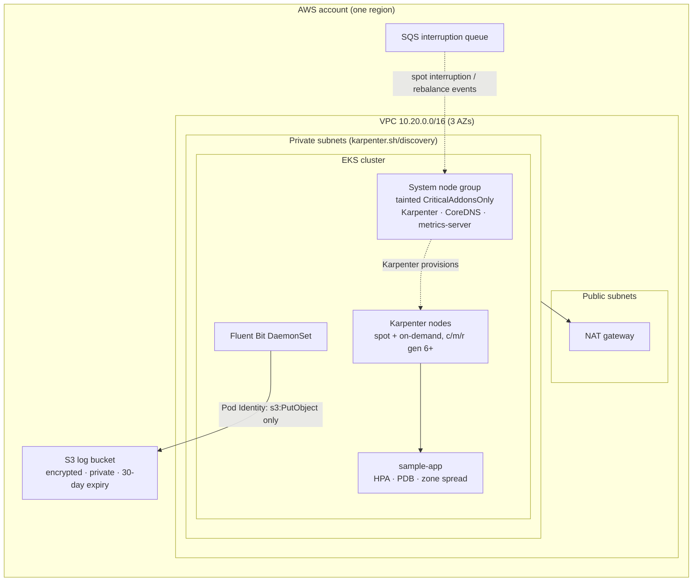

# eks-platform-reference

A production-shaped reference platform on Amazon EKS: Terraform for the network and cluster, Karpenter for just-in-time compute, a hardened sample workload, and Fluent Bit shipping enriched container logs to S3. Everything is deployed and torn down by idempotent, phase-based PowerShell scripts.

It's small enough to run in a sandbox account for an afternoon, and it encodes the patterns I use when building and operating EKS platforms in production.

## Architecture



## What it demonstrates

| Area | Pattern |
| --- | --- |
| Network | Three-AZ VPC; pods on large private subnets (VPC CNI gives every pod a VPC IP); load balancers on public subnets; discovery tags for Karpenter and the AWS load balancer integrations |
| Compute | A small, tainted system node group for cluster-critical add-ons; all application capacity from Karpenter (spot and on-demand, consolidation, monthly node expiry, 20% disruption budget) |
| Identity | EKS access entries instead of the `aws-auth` ConfigMap; EKS Pod Identity for Karpenter and Fluent Bit instead of node-wide IAM; IMDSv2 with hop limit 1 so pods can't borrow node credentials |
| Workload | Helm chart with HPA, PodDisruptionBudget, zone-then-node topology spread, rolling updates with `maxUnavailable: 0`, non-root read-only containers with all capabilities dropped |
| Logging | Fluent Bit with Kustomize base and overlays (stdout locally, S3 on AWS), Kubernetes metadata enrichment, multiline parsing that rejoins stack traces from Java, Python, Go, .NET and Node services |
| Operations | Phase-based, re-runnable deploy and teardown scripts with `-WhatIf`; teardown order that avoids orphaned instances; CI that validates Terraform, Helm, Kustomize and PowerShell on every push |

## Repository layout

```
terraform/                 VPC, EKS, Karpenter IAM + controller, metrics-server, log bucket
karpenter/                 EC2NodeClass and NodePool (templated from Terraform outputs)
charts/sample-app/         Hardened sample workload
logging/fluent-bit/
  base/                    DaemonSet, RBAC, config, multiline parsers
  overlays/local/          stdout output for kind / minikube / Docker Desktop
  overlays/aws/            S3 output via Pod Identity
scripts/
  Deploy.ps1               Infra → Karpenter → Logging → App
  Teardown.ps1             App → Logging → Karpenter (wait for nodes) → Infra
docs/design-notes.md       Decisions, trade-offs, and failure modes this design avoids
.github/workflows/         fmt, validate, lint and render checks
```

## Prerequisites

- An AWS sandbox account and credentials with permission to create VPC, EKS, IAM, SQS and S3 resources
- Terraform ≥ 1.6, AWS CLI v2, kubectl, Helm 3, PowerShell 7.4+

## Quick start

```powershell
Copy-Item terraform/terraform.tfvars.example terraform/terraform.tfvars
# Edit terraform.tfvars: set api_allowed_cidrs to your own IP (e.g. "203.0.113.10/32")

./scripts/Deploy.ps1 -WhatIf     # preview the phases
./scripts/Deploy.ps1             # build everything (about 20 minutes)
```

Watch Karpenter react to demand:

```powershell
kubectl -n sample-app scale deployment sample-app --replicas=30   # or let the HPA do it under load
kubectl get nodes -l karpenter.sh/nodepool -w
```

Check that logs are arriving:

```powershell
$bucket = terraform -chdir=terraform output -raw logs_bucket
aws s3 ls "s3://${bucket}/containers/" --recursive | Select-Object -First 10
```

## Teardown

```powershell
./scripts/Teardown.ps1
```

Teardown deletes the Karpenter NodePool and waits for its nodes to terminate **before** running `terraform destroy`. Karpenter launches instances Terraform doesn't know about; destroying the VPC first leaves those instances and their network interfaces behind and the destroy fails.

## Cost

This creates billable resources: an EKS control plane, a NAT gateway, two `m6i.large` system nodes, and whatever Karpenter launches. Run it in a sandbox, keep `single_nat_gateway = true`, and tear it down when you're finished.

## Design notes

See [docs/design-notes.md](docs/design-notes.md) for the reasoning behind the main choices and the production failure modes they're meant to prevent.

## License

MIT. See [LICENSE](LICENSE).
